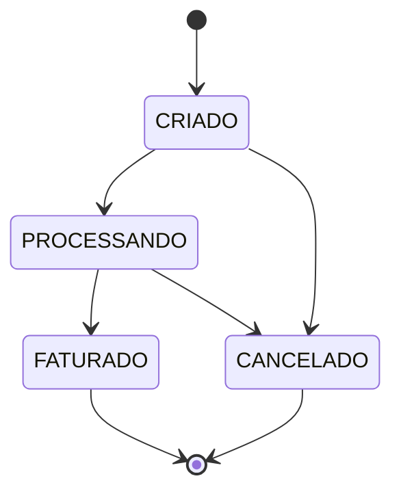

# API REST — Módulo de Pedidos ERP

## 1. Apresentação

API REST desenvolvida em Java e Spring Boot para gerenciamento de pedidos de venda de um ERP.

A aplicação permite criar, consultar, listar e alterar o status de pedidos, garantindo a consistência dos valores financeiros, a idempotência na criação e o controle de concorrência nas alterações de estado.

## 2. Tecnologias utilizadas

- Java 17
- Spring Boot 4.2.0
- Spring Web MVC
- Spring Data JPA
- Hibernate
- Bean Validation
- Spring Boot Actuator
- PostgreSQL 17
- Flyway
- Lombok
- Maven
- Docker e Docker Compose
- JUnit 5
- Mockito
- Testcontainers

## 3. Pré-requisitos

Para executar a aplicação, é necessário possuir:

- JDK 17 ou superior, compatível com a versão do projeto.
- Docker com Docker Compose.
- Git.

O projeto disponibiliza o Maven Wrapper, não sendo necessária a instalação do Maven separadamente.

## 4. Executando a aplicação

### 4.1. Clonar o repositório

```bash
git clone https://github.com/ggpguime-source/pedido.git
cd pedido
```

### 4.2. Inicializar o PostgreSQL

```bash
docker compose up -d
```

Verificar a disponibilidade do banco:

```bash
docker compose exec postgres pg_isready -U pedido -d pedidos
```

### 4.3. Configuração do banco de dados

A configuração padrão para desenvolvimento está disponível no arquivo `application.yaml`.

| Propriedade | Valor |
|---|---|
| Host | localhost |
| Porta | 5433 |
| Database | pedidos |
| Usuário | pedido |
| Senha | pedido123 |

URL de conexão:

```text
jdbc:postgresql://localhost:5433/pedidos
```

A senha utilizada pela aplicação pode ser sobrescrita pela variável de ambiente `DB_PASSWORD`, devendo corresponder à senha configurada no PostgreSQL.

As credenciais padrão são destinadas exclusivamente ao ambiente de desenvolvimento.

### 4.4. Inicializar a aplicação

Windows:

```powershell
.\mvnw.cmd spring-boot:run
```

Linux ou macOS:

```bash
./mvnw spring-boot:run
```

A aplicação estará disponível em:

```text
http://localhost:8080
```

O endpoint de saúde da aplicação pode ser consultado em:

```http
GET /actuator/health
```

### 4.5. Encerrar o ambiente

Após interromper a aplicação:

```bash
docker compose down
```

Os dados do PostgreSQL serão preservados no volume configurado pelo Docker Compose.

## 5. Banco de dados

O gerenciamento da estrutura do banco de dados é realizado pelo Flyway.

As migrations estão localizadas em:

```text
src/main/resources/db/migration/
```

| Migration | Responsabilidade |
|---|---|
| V1__criar_tabelas.sql | Criação das tabelas e constraints |
| V2__inserir_dados_iniciais.sql | Cadastro inicial de clientes e produtos |

O Hibernate está configurado com `ddl-auto: validate`, sendo responsável pela validação do mapeamento das entidades, sem realizar alterações automáticas na estrutura do banco.

### 5.1. Dados iniciais

Clientes:

| ID | Nome |
|---|---|
| 1 | João da Silva |
| 2 | Maria Oliveira |
| 3 | Pedro Santos |

Produtos:

| ID | Produto | Preço | Desconto |
|---|---|---:|---:|
| 1 | Arroz 5kg | 25,90 | 10% |
| 2 | Feijão 1kg | 9,90 | 0% |
| 3 | Açúcar 5kg | 15,90 | 5% |
| 4 | Bolacha de Morango 500g | 5,90 | 0% |
| 5 | Queijo 200g | 7,90 | 10% |

Os identificadores apresentados correspondem a uma base inicializada do zero.

## 6. Estrutura do projeto

```text
src/main/java/com/erp/pedido/
├── controller
├── domain
├── dto
├── entity
├── enums
├── exception
├── mapper
├── repository
├── service
└── util
```

| Pacote | Responsabilidade |
|---|---|
| controller | Exposição dos endpoints REST |
| domain | Representação dos objetos de negócio |
| dto | Contratos de entrada e saída da API |
| entity | Mapeamento das entidades JPA |
| enums | Definição dos estados da aplicação |
| exception | Tratamento centralizado de exceções |
| mapper | Conversão entre DTOs, objetos de domínio e entidades |
| repository | Comunicação com o banco de dados |
| service | Regras de negócio e controle transacional |
| util | Funcionalidades auxiliares |

A separação entre DTOs, objetos de domínio e entidades permite que os contratos da API e os mapeamentos de persistência evoluam de maneira independente.

## 7. Endpoints

| Método | Endpoint | Descrição |
|---|---|---|
| POST | /pedidos | Criar pedido |
| GET | /pedidos/{id} | Consultar pedido |
| GET | /pedidos | Listar pedidos |
| PATCH | /pedidos/{id}/status | Alterar status ou cancelar pedido |

### 7.1. Criar pedido

```http
POST /pedidos
Content-Type: application/json
RequestID: pedido-exemplo-001
```

Request:

```json
{
    "cliente": {
        "id": 1
    },
    "itens": [
        {
            "produto": {
                "id": 1
            },
            "quantidade": 2
        },
        {
            "produto": {
                "id": 3
            },
            "quantidade": 1
        }
    ]
}
```

Response — HTTP 201 Created:

```json
{
    "id": 1,
    "cliente": {
        "id": 1,
        "nome": "João da Silva"
    },
    "subtotal": 67.70,
    "descontoTotal": 5.98,
    "valorTotal": 61.72,
    "status": "CRIADO",
    "dataCriacao": "2026-11-26T17:30:00Z",
    "itens": [
        {
            "produto": {
                "id": 1,
                "nome": "Arroz 5kg",
                "descricao": "Arroz branco tipo 1"
            },
            "quantidade": 2,
            "precoUnitario": 25.90,
            "descontoPercentual": 10.00,
            "desconto": 5.18,
            "valorTotal": 46.62
        },
        {
            "produto": {
                "id": 3,
                "nome": "Açucar 5kg",
                "descricao": "Açucar docinho da maria"
            },
            "quantidade": 1,
            "precoUnitario": 15.90,
            "descontoPercentual": 5.00,
            "desconto": 0.80,
            "valorTotal": 15.10
        }
    ]
}
```

Header de resposta:

```http
Location: /pedidos/1
```

O identificador e a data de criação são ilustrativos.

### 7.2. Consultar pedido

```http
GET /pedidos/1
```

Retorna HTTP 200 com os dados completos do pedido, seguindo a mesma estrutura de resposta utilizada na criação.

Caso o pedido não exista, retorna HTTP 404.

### 7.3. Listar pedidos

```http
GET /pedidos?page=0&size=20
```

Listagem filtrada por cliente:

```http
GET /pedidos?page=0&size=20&clienteId=1
```

Parâmetros:

| Parâmetro | Obrigatório | Padrão |
|---|---|---|
| page | Não | 0 |
| size | Não | 20 |
| clienteId | Não | Todos os clientes |

A quantidade máxima de registros por página é 100.

A ordenação padrão considera a data de criação e o identificador do pedido em ordem decrescente.

Response — HTTP 200 OK:

```json
{
    "content": [
        {
            "id": 1,
            "cliente": {
                "id": 1,
                "nome": "João da Silva"
            },
            "valorTotal": 61.72,
            "status": "CRIADO",
            "dataCriacao": "2026-11-26T17:30:00Z"
        }
    ],
    "page": 0,
    "size": 20,
    "totalElements": 1,
    "totalPages": 1
}
```

Caso nenhum pedido corresponda aos parâmetros informados, a aplicação retorna HTTP 200 com uma lista vazia.

### 7.4. Alterar status

```http
PATCH /pedidos/1/status
Content-Type: application/json
```

Request:

```json
{
    "status": "PROCESSANDO"
}
```

Response:

```http
204 No Content
```

O cancelamento utiliza o mesmo endpoint:

```json
{
    "status": "CANCELADO"
}
```

As transições são validadas de acordo com o estado atual do pedido.

## 8. Regras de negócio

### 8.1. Criação do pedido

Durante a criação, a aplicação realiza:

1. Validação dos dados recebidos.
2. Registro do identificador da requisição.
3. Validação da existência do cliente.
4. Consulta dos produtos informados.
5. Cálculo dos valores e descontos.
6. Definição do status inicial como CRIADO.
7. Definição da data de criação.
8. Persistência do pedido e seus itens.
9. Conclusão do registro da requisição.

As operações de banco de dados relacionadas à criação são executadas dentro de uma única transação.

### 8.2. Cálculos financeiros

Os valores financeiros são gerenciados e calculados exclusivamente pela aplicação.

O consumidor informa apenas os identificadores do cliente e dos produtos, além das respectivas quantidades.

O preço unitário e o percentual de desconto são recuperados do cadastro de produtos.

Os cálculos utilizam `BigDecimal`, com arredondamento `HALF_UP` para duas casas decimais no cálculo do desconto de cada item.

```text
Subtotal do item = Preço unitário × Quantidade

Desconto = Subtotal do item × Percentual de desconto / 100

Valor total do item = Subtotal do item - Desconto

Valor total do pedido = Subtotal do pedido - Desconto total
```

Os valores financeiros são armazenados nos itens do pedido, preservando os preços e descontos aplicados no momento da compra, independentemente de alterações posteriores no cadastro dos produtos.

Os nomes e descrições dos produtos continuam associados ao cadastro atual.

### 8.3. Máquina de estados



| Status atual | Transições permitidas |
|---|---|
| CRIADO | PROCESSANDO, CANCELADO |
| PROCESSANDO | FATURADO, CANCELADO |
| FATURADO | Nenhuma |
| CANCELADO | Nenhuma |

Os estados FATURADO e CANCELADO são definitivos.

Transições inválidas retornam HTTP 409 Conflict.

## 9. Idempotência

Para evitar a criação duplicada de pedidos em situações de retry, timeout ou reenvio de requisições, foi implementado um mecanismo de idempotência baseado no header `RequestID`.

O identificador deve ser gerado pelo consumidor da API e reutilizado nas tentativas referentes à mesma operação de criação.

Uma nova operação deve possuir um novo identificador.

### 9.1. Registro de requisições

A tabela `request` armazena:

| Campo | Responsabilidade |
|---|---|
| request_id | Identificador único da requisição |
| request_hash | Hash do conteúdo recebido |
| pedido_id | Pedido associado |
| status | Estado do processamento da requisição |

O `request_id` é utilizado como chave primária, garantindo sua unicidade no PostgreSQL.

O registro é realizado utilizando:

```sql
INSERT INTO request (request_id, request_hash, status)
VALUES (:requestId, :requestHash, 'PROCESSANDO')
ON CONFLICT (request_id) DO NOTHING;
```

Essa abordagem permite que o próprio banco de dados controle a disputa entre requisições que utilizem o mesmo identificador, inclusive quando processadas por diferentes instâncias da aplicação.

### 9.2. Validação do conteúdo

A aplicação gera um hash SHA-256 considerando:

- Identificador do cliente.
- Identificadores dos produtos.
- Quantidades solicitadas.

A ordem dos itens é preservada na geração do hash.

### 9.3. Comportamentos

| Cenário | Resultado |
|---|---|
| Novo RequestID | Criação do pedido |
| Mesmo RequestID e mesmo conteúdo | Retorno do pedido existente |
| Mesmo RequestID e conteúdo diferente | HTTP 409 Conflict |
| Falha durante a criação | Rollback da transação |

O reenvio de uma requisição concluída retorna HTTP 201 com a representação atual do pedido existente, sem realizar uma nova criação.

O registro da requisição e a persistência do pedido fazem parte da mesma transação. Caso ocorra uma falha, ambos são revertidos, permitindo uma nova tentativa.

## 10. Controle de concorrência

Para evitar inconsistências durante alterações simultâneas de status, foi adotado o bloqueio pessimista de escrita.

```java
@Lock(LockModeType.PESSIMISTIC_WRITE)
@Query("SELECT p FROM PedidoEntity p WHERE p.id = :id")
Optional<PedidoEntity> findByIdForUpdate(@Param("id") Long id);
```

A alteração de status é executada dentro de uma transação.

A aplicação adquire o bloqueio antes de consultar e validar o estado do pedido para alteração.

Caso duas operações incompatíveis sejam solicitadas simultaneamente, uma delas deverá aguardar a liberação do registro. Após adquirir o bloqueio, a segunda operação validará o estado atualizado do pedido.

Por exemplo, em uma disputa entre faturamento e cancelamento, apenas uma das operações poderá ser concluída com sucesso.

O bloqueio é gerenciado pelo PostgreSQL, não dependendo de mecanismos de sincronização locais da JVM.

## 11. Tratamento de exceções

O tratamento de exceções é centralizado através de `@RestControllerAdvice`.

| HTTP | Código | Descrição |
|---|---|---|
| 400 | VALIDATION_ERROR | Falha na validação dos dados |
| 400 | INVALID_REQUEST | Requisição inválida |
| 404 | NOT_FOUND | Pedido inexistente |
| 409 | CONFLICT | Conflito de estado ou idempotência |
| 422 | BUSINESS_ERROR | Violação de regra de negócio |
| 500 | INTERNAL_ERROR | Erro inesperado |

Exemplo de tentativa de cancelamento de um pedido faturado:

```json
{
    "codigo": "CONFLICT",
    "mensagem": "Status do pedido em estado definitivo = FATURADO",
    "traceId": null
}
```

Erros inesperados são registrados no log da aplicação, sem exposição da stack trace ao consumidor.

Exceções HTTP nativas do Spring não tratadas explicitamente preservam seus respectivos códigos, headers e formato de resposta.

O campo `traceId` está reservado para uma futura implementação de rastreamento distribuído.

## 12. Testes automatizados

Os testes foram desenvolvidos utilizando JUnit 5, Mockito e Testcontainers.

### 12.1. Testes unitários

A classe `PedidoServiceTest` valida:

- Transições válidas de status.
- Transições inválidas de status.
- Restrições dos estados definitivos.
- Consulta de pedido inexistente.
- Alteração de pedido inexistente.

As dependências do Service são isoladas através do Mockito.

### 12.2. Testes de integração

A classe `PedidoServiceIntegrationTest` utiliza uma instância isolada do PostgreSQL 17, disponibilizada pelo Testcontainers.

São validados os seguintes comportamentos:

- Criação, cálculo, persistência e consulta do pedido.
- Idempotência com o mesmo conteúdo.
- Conflito de idempotência.
- Rollback transacional.
- Paginação e filtro por cliente.
- Concorrência entre faturamento e cancelamento.

### 12.3. Executar os testes

O Docker deve estar em execução para os testes de integração.

Windows:

```powershell
.\mvnw.cmd clean test
```

Linux ou macOS:

```bash
./mvnw clean test
```

Execução individual dos testes unitários:

```powershell
.\mvnw.cmd test "-Dtest=PedidoServiceTest"
```

Execução individual dos testes de integração:

```powershell
.\mvnw.cmd test "-Dtest=PedidoServiceIntegrationTest"
```

### 12.4. Resultado da execução

| Categoria | Testes |
|---|---:|
| Unitários | 18 |
| Integração | 6 |
| Inicialização do contexto | 1 |
| Total | 25 |

Resultado da execução realizada em 26/11/2026:

```text
Tests run: 25, Failures: 0, Errors: 0, Skipped: 0

BUILD SUCCESS
```

## 13. Decisões técnicas

- Utilização de uma arquitetura em camadas, mantendo as responsabilidades de comunicação, negócio e persistência separadas.
- Separação entre DTOs, objetos de domínio e entidades JPA.
- Centralização das regras de negócio na camada Service.
- Utilização do Flyway para versionamento da estrutura do banco.
- Utilização de transações para garantir a atomicidade das operações.
- Utilização de restrições no banco de dados como proteção adicional à consistência dos dados.
- Controle de idempotência através de identificadores únicos e hash do conteúdo.
- Bloqueio pessimista para alterações concorrentes de status.
- Utilização do PostgreSQL real nos testes de integração.

A implementação disponibiliza as transições de status através de um único endpoint, permitindo demonstrar as regras de negócio e o controle de concorrência sem depender de um serviço externo de faturamento.

O processamento assíncrono, a mensageria, o padrão Transactional Outbox e as estratégias de escalabilidade e observabilidade são detalhados no documento de arquitetura como propostas para a evolução da solução, não estando integralmente implementados nesta versão.